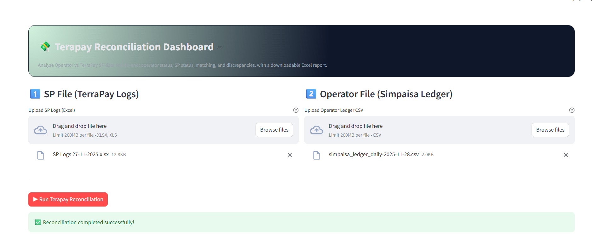
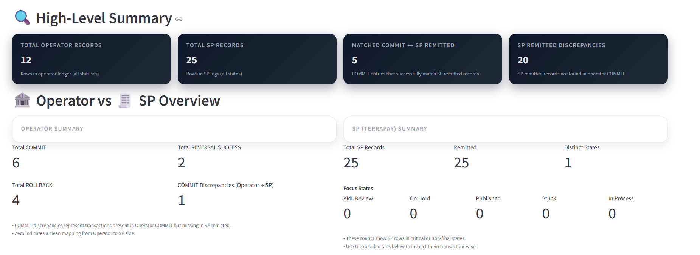
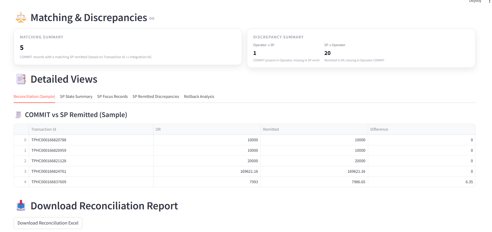

<div align="center">

# 💸 TerraPay Reconciliation Dashboard

**Automated end-to-end reconciliation between the Simpaisa operator ledger and TerraPay SP logs, built with Python, Pandas and Streamlit.**

!\[Python](https://img.shields.io/badge/Python-3.11-3776AB?logo=python\&logoColor=white)
!\[Streamlit](https://img.shields.io/badge/Streamlit-App-FF4B4B?logo=streamlit\&logoColor=white)
!\[Pandas](https://img.shields.io/badge/Pandas-Data%20Processing-150458?logo=pandas\&logoColor=white)
!\[Excel](https://img.shields.io/badge/Output-Excel%20Report-217346?logo=microsoftexcel\&logoColor=white)
!\[License](https://img.shields.io/badge/License-MIT-green)



</div>

\---

## 📌 Overview

Daily reconciliation between a payment operator's ledger and a remittance partner's settlement logs is usually a slow, manual Excel exercise. This project turns it into a **one-click workflow**:

1. Upload the **SP Logs** (TerraPay, Excel) and the **Operator Ledger** (Simpaisa, CSV)
2. Click **Run Terapay Reconciliation**
3. Get an interactive dashboard plus a **multi-sheet Excel report** of every match, mismatch, stuck transaction and rollback issue

The whole application (backend reconciliation engine + Streamlit frontend) lives in a single file: [`terapay\_recon.py`](terapay_recon.py).

\---

## ✨ Features

|Area|What it does|
|-|-|
|🧹 **Data cleaning**|Strips leading apostrophes and whitespace from IDs, coerces DR/CR/Remitted to numeric|
|🏦 **Operator analysis**|Counts COMMIT, ROLLBACK and REVERSAL SUCCESS records; detects duplicate Transaction IDs|
|🧾 **SP analysis**|State-wise distribution and focus states: `aml\_review`, `on\_hold`, `published`, `stuck`, `in process`|
|⚖️ **Two-way matching**|Operator COMMIT ↔ SP Remitted on `Transaction Id` ↔ `Integration Id`, with amount difference (`DR − Remitted`)|
|🚨 **Discrepancies**|COMMIT present in operator but missing in SP, and remitted in SP but missing in operator|
|🔁 **Rollback checks**|Groups rollbacks by `Partner TxnId` and flags missing debit, missing credit or unbalanced pairs|
|📊 **Dashboard**|KPI cards, operator vs SP overview, discrepancy summary and tabbed detail views|
|📥 **Excel export**|8-sheet reconciliation report, downloadable in one click|

\---

## 🔄 How It Works

```mermaid
flowchart LR
    A\[SP Logs<br/>TerraPay .xlsx] --> C\[Clean \& Normalize IDs]
    B\[Operator Ledger<br/>Simpaisa .csv] --> C
    C --> D\[Operator Status Split<br/>COMMIT / ROLLBACK / REVERSAL]
    C --> E\[SP State Split<br/>Remitted / Focus States]
    D --> F{Match<br/>Transaction Id ↔ Integration Id}
    E --> F
    F --> G\[Reconciliation<br/>DR vs Remitted]
    F --> H\[Operator → SP<br/>Discrepancies]
    F --> I\[SP → Operator<br/>Discrepancies]
    D --> J\[Rollback DR/CR<br/>Balance Check]
    G \& H \& I \& J --> K\[📊 Streamlit Dashboard]
    G \& H \& I \& J --> L\[📥 Excel Report]
```

\---

## 🖼️ Screenshots

### High-Level Summary \& Operator vs SP Overview



### Matching, Discrepancies \& Detailed Views



### Sample run (files in `data/sample/`)

|Metric|Value|
|-|-|
|Operator records|12|
|SP records|25|
|COMMIT ↔ SP Remitted matched|5|
|COMMIT discrepancies (Operator → SP)|1|
|SP remitted discrepancies (SP → Operator)|20|
|Amount mismatches caught|1 (difference of 6.35)|

\---

## 📁 Project Structure

```
terapay-reconciliation/
├── terapay\_recon.py          # Single-file app: reconciliation engine + Streamlit UI
├── requirements.txt          # Python dependencies
├── data/
│   └── sample/
│       ├── SP Logs 27-11-2025.xlsx                  # TerraPay SP logs (input 1)
│       └── simpaisa\_ledger\_daily-2025-11-28.csv     # Operator ledger (input 2)
├── assets/
│   └── screenshots/          # UI screenshots used in this README
├── .gitignore
├── LICENSE
└── README.md
```

\---

## 🚀 Getting Started

### 1\. Clone the repository

```bash
git clone https://github.com/sameedtaj/terapay-reconciliation.git

cd terapay-reconciliation

```

### 2\. Install dependencies

```bash
pip install -r requirements.txt
```

### 3\. Run the app

```bash
python -m streamlit run terapay\_recon.py
```

The dashboard opens at **http://localhost:8501**.

### 4\. Reconcile

Upload the two files from `data/sample/` (or your own), click **▶ Run Terapay Reconciliation**, then download the Excel report.

\---

## 📥 Input File Format

**Operator Ledger (CSV)** must contain:

|Column|Description|
|-|-|
|`Transaction Id`|Operator transaction reference (matched to SP `Integration Id`)|
|`Partner TxnId`|Partner reference, used to pair rollback debits/credits|
|`DR`|Debit amount|
|`CR`|Credit amount|
|`Remarks`|`COMMIT`, `ROLLBACK` or `REVERSAL SUCCESS`|

**SP Logs (Excel)** must contain:

|Column|Description|
|-|-|
|`Integration Id`|SP transaction reference|
|`State`|e.g. `remitted`, `aml\_review`, `on\_hold`, `published`, `stuck`, `in process`|
|`Remitted`|Remitted amount|

\---

## 📤 Output Excel Report

|Sheet|Contents|
|-|-|
|`Reconciliation`|Matched COMMIT ↔ SP remitted with DR, Remitted and Difference|
|`Rollback\_Summary`|Per `Partner TxnId` totals of DR/CR with debit, credit and balance flags|
|`Rollback\_Problem\_Cases`|Rollbacks missing a debit, missing a credit, or unbalanced|
|`Commit\_Discrepancies`|COMMIT in operator but not remitted in SP|
|`Reversal\_Success`|All REVERSAL SUCCESS records|
|`SP\_State\_Summary`|Count of SP records per state|
|`SP\_Stucks`|SP records in focus (non-final) states|
|`SP\_Remitted\_Discrepancies`|Remitted in SP but not found in operator COMMIT|

\---

## 🛠️ Tech Stack

* **Python 3.11**
* **Pandas** for cleaning, merging and aggregation
* **Streamlit** for the interactive dashboard
* **XlsxWriter / OpenPyXL** for reading and writing Excel

\---

## 🗺️ Roadmap

* \[ ] Configurable tolerance for amount differences
* \[ ] Date-range filtering and multi-day batch reconciliation
* \[ ] Charts for state distribution and discrepancy trends
* \[ ] Docker image and cloud deployment
* \[ ] Scheduled runs with email summary

\---

## 👤 Author

**Muhammad Sameed**, Data Scientist / Data Analyst at Simpaisa

[!\[GitHub](https://img.shields.io/badge/GitHub-Profile-181717?logo=github)](https://github.com/<your-username>)
[!\[LinkedIn](https://img.shields.io/badge/LinkedIn-Connect-0A66C2?logo=linkedin)](https://www.linkedin.com/in/<your-linkedin>)

\---

## 📄 License

Released under the [MIT License](LICENSE).

